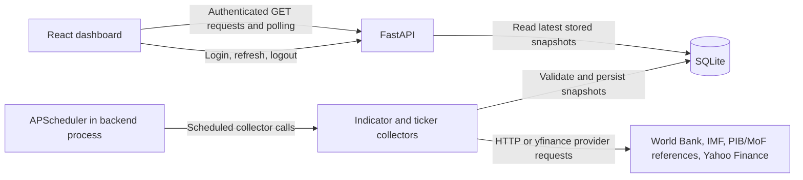

# Economic Indicators Dashboard

A React dashboard backed by a FastAPI service for viewing selected Indian economic indicators and market-index snapshots. The backend collects and stores provider data; authenticated browser requests read those stored snapshots. The project is intended to make a compact set of public economic series easier to browse, with source dates and stale-data states visible where available.

> This README documents the implementation in this repository. Upstream availability, data freshness, and hosted deployment have not been independently verified here.

## Contents

- [Features](#features)
- [Screenshots and demo](#screenshots-and-demo)
- [Technology stack](#technology-stack)
- [Architecture](#architecture)
- [Repository structure](#repository-structure)
- [Prerequisites and local setup](#prerequisites-and-local-setup)
- [Configuration reference](#configuration-reference)
- [Data sources and collection behavior](#data-sources-and-collection-behavior)
- [Scheduler and refresh semantics](#scheduler-and-refresh-semantics)
- [API documentation](#api-documentation)
- [Authentication and security](#authentication-and-security)
- [Testing and code quality](#testing-and-code-quality)
- [Known limitations and future improvements](#known-limitations-and-future-improvements)
- [Contributing, license, and acknowledgements](#contributing-license-and-acknowledgements)

## Features

The protected dashboard provides six indicator panels:

1. **GDP growth** — India and world annual growth series.
2. **Inflation** — India CPI inflation series and a displayed 4% RBI target reference.
3. **Government debt** — IMF general-government gross debt as a percentage of GDP, with India and US series.
4. **Government expenditure** — World Bank government-finance series presented as total, revenue-proxy, and capital-proxy expenditure.
5. **GST revenue** — curated annual totals and a limited monthly series, with year-over-year values.
6. **Trade** — imports, exports, and a derived trade balance.

The interface also includes a SENSEX, NIFTY BANK, and NIFTY IT ticker; login and protected dashboard access; charts and tooltips; and loading, empty, error, unavailable, and stale-data states. Indicator freshness is based on observation age, while fetch time is shown separately. A failed refresh retains previously stored valid observations where collector logic supports it.

## Screenshots and demo

The repository includes [`extracted_figma_ref_0.png`](extracted_figma_ref_0.png), an assignment design-reference export. It is not a screenshot of the running application. Add verified application screenshots here when they are available.

- Hosted demo: **not configured**
- Submission, portfolio, or recording links: **not configured**

## Technology stack

| Area | Technologies in the project |
| --- | --- |
| Frontend | React 19, Vite 8, Axios, React Router package, Oxlint |
| Charts | Recharts |
| Backend/API | Python, FastAPI, Pydantic Settings, Uvicorn, HTTPX |
| Database | SQLite via Python `sqlite3` |
| Authentication | `python-jose` JWT signing, bcrypt password hashing, refresh-token hashes stored by the backend |
| Scheduling | APScheduler (`AsyncIOScheduler`) |
| Market data | `yfinance` / Yahoo Finance daily bars |
| Tests | pytest; frontend lint and Vite production build scripts |

The backend dependencies are pinned in `backend/requirements.txt`; pytest is declared in `backend/requirements-dev.txt`. Frontend dependency ranges and scripts are in `frontend/package.json` and the npm lockfile.

## Architecture



The browser reads backend snapshots. Dashboard reload and panel retry repeat API reads; they do not request a collector run. The backend scheduler independently runs collectors and writes snapshots to SQLite. A successful API response therefore confirms that the API returned a response, not that the upstream provider supplied new data during that request.

## Repository structure

```text
.
├── assignment.pdf
├── extracted_figma_ref_0.png
├── README.md
├── backend/
│   ├── app/
│   │   ├── auth/                 # login, JWT and refresh-token handling
│   │   ├── collectors/           # six indicator collectors, ticker and scheduler
│   │   ├── models/schemas.py     # API response models
│   │   ├── routers/              # health, indicators and ticker endpoints
│   │   ├── utils/                # HTTP client and freshness rules
│   │   ├── config.py
│   │   ├── database.py
│   │   └── main.py               # FastAPI application and startup
│   ├── db/schema.sql
│   ├── tests/
│   ├── requirements.txt
│   └── requirements-dev.txt
└── frontend/
    ├── public/
    ├── src/
    │   ├── api/
    │   ├── auth/
    │   └── components/           # layout, indicator panels and chart UI
    ├── package.json
    └── vite.config.js
```

Runtime databases, environment files, `node_modules`, virtual environments, and build output are local/generated and excluded by `.gitignore`.

## Prerequisites and local setup

Use Python 3.10 or later (the source uses modern Python type syntax), Node.js compatible with Vite 8, and npm. Exact Python and Node patch versions are not pinned in repository metadata.

### Backend

In PowerShell, from the repository root:

```powershell
cd backend
python -m venv .venv
.\.venv\Scripts\Activate.ps1
python -m pip install -r requirements.txt
```

The backend creates or migrates its SQLite schema on startup. With the default `DATABASE_URL`, start the application from `backend/` so the relative SQLite file is `backend/db/indicators.db`:

```powershell
$env:APP_ENV = "development"
$env:JWT_SECRET_KEY = "replace-with-a-private-local-key-at-least-32-bytes"
$env:EVALUATOR_USERNAME = "evaluator"
$env:EVALUATOR_PASSWORD = "set-a-private-local-password"
$env:SCHEDULER_ENABLED = "false"
python -m uvicorn app.main:app --reload --host 127.0.0.1 --port 8000
```

Set `EVALUATOR_PASSWORD` to a private value in your shell; do not put a real credential in this README, source control, or shared terminal transcript. The application seeds the evaluator account on startup only when both evaluator settings are supplied. Set `SCHEDULER_ENABLED=true` to enable background collection (including startup collection).

### Frontend

In a second PowerShell terminal, from the repository root:

```powershell
cd frontend
npm install
$env:VITE_API_BASE_URL = "http://localhost:8000"
npm run dev
```

Vite serves the development UI at `http://localhost:5173` by default. The API listens at `http://127.0.0.1:8000`; the frontend API client uses a 10-second request timeout. For production builds, `VITE_API_BASE_URL` is compiled into the bundle and must use HTTPS.

No `.env.example` file is present. Configure variables in the current PowerShell session as shown above or create a private, ignored local `.env` based on the variable reference below. Backend settings load `.env` from the backend process working directory. Never commit `.env` files, database files, or credentials.

## Configuration reference

Defaults below are from the settings model. “Required in production” describes startup validation; development behavior may still require a value for a feature to work (for example, login needs evaluator credentials).

| Variable | Purpose | Default | Required in production? |
| --- | --- | --- | --- |
| `APP_ENV` | Runtime mode and production validation; production disables interactive API docs. | `development` | No |
| `JWT_SECRET_KEY` | HS256 signing key. Production rejects the placeholder and requires at least 32 UTF-8 bytes. | `CHANGE_ME_IN_PRODUCTION` | Yes |
| `JWT_ALGORITHM` | JWT algorithm; configuration accepts HS256. | `HS256` | No, but must remain `HS256` |
| `ACCESS_TOKEN_EXPIRE_MINUTES` | Access-token lifetime. | `30` | No |
| `REFRESH_TOKEN_EXPIRE_DAYS` | Refresh-token lifetime. | `7` | No |
| `DATABASE_URL` | SQLite database URL. The database is backend-only. | `sqlite:///./db/indicators.db` | No; production must provide private persistent storage operationally |
| `CORS_ORIGINS` | Comma-separated allowed browser origins. Production validation requires HTTPS origins. | `http://localhost:5173` | Yes, set the deployed frontend origin(s) |
| `EVALUATOR_USERNAME` | Username for the seeded evaluator account. | `evaluator` | Yes, non-empty |
| `EVALUATOR_PASSWORD` | Password used to seed the evaluator account. Production enforces length and character-class checks. | unset | Yes; 16–72 UTF-8 bytes and at least three character classes |
| `SCHEDULER_ENABLED` | Enable scheduled and initial collector runs. | `true` | No |
| `TICKER_REFRESH_SECONDS` | Backend ticker collector interval. | `30` | No |
| `APP_TITLE` | API title metadata. | `Economic Indicators API` | No |
| `APP_VERSION` | API version metadata. | `1.0.0` | No |
| `VITE_API_BASE_URL` | Frontend API origin, embedded at build time. | `http://localhost:8000` | Set to the HTTPS API origin for production |

`VITE_API_BASE_URL` is a frontend build variable, not a backend setting. It must never contain a secret. The scheduler uses UTC; the listed IST times are UTC+05:30.

## Data sources and collection behavior

All collectors run in the backend. Source URLs below reflect those configured in code; provider availability and values are not independently certified by this documentation.

| Panel / feed | Provider and source | Granularity, transformations, and limitations |
| --- | --- | --- |
| GDP growth | [World Bank API](https://api.worldbank.org/v2/country/IN/indicator/NY.GDP.MKTP.KD.ZG?format=json&mrv=10); India and world use `NY.GDP.MKTP.KD.ZG`. | Annual percentage series, up to ten recent values. Source observation periods may lag current time. |
| Government debt | [IMF WEO DataMapper](https://www.imf.org/external/datamapper/api/v1/GGXWDG_NGDP/IND/USA), `GGXWDG_NGDP`. | Annual general-government gross debt (% GDP), India and US. The endpoint returns year/value pairs without reliable actual/estimate status metadata. Future calendar years are labelled projections in the application; current and elapsed periods may contain estimates and are not reliably classified. `as_of` excludes future projections and represents the latest completed annual period available. |
| Imports, exports, trade balance | [World Bank API](https://api.worldbank.org/v2/country/IN/indicator/NE.EXP.GNFS.CD?format=json&mrv=10) for exports (`NE.EXP.GNFS.CD`) and [imports](https://api.worldbank.org/v2/country/IN/indicator/NE.IMP.GNFS.CD?format=json&mrv=10). | Annual current USD values are converted to USD billions; trade balance is derived as exports minus imports. It is not an independently collected series. |
| GST revenue | Curated values attributed to [PIB / Ministry of Finance](https://www.pib.gov.in/PressNoteDetails.aspx?ModuleId=3&NoteId=154789&id=154789&lang=2&reg=3). | Static annual totals cover FY2020–21 through FY2024–25; curated monthly values cover April 2024–February 2025. The collector does not fetch a live upstream series. The chart's annual monthly line is the annual total divided by 12, an average proxy rather than observed monthly data. The year-over-year series is calculated from annual totals. Coverage and underlying source figures have not been independently refreshed or verified here. |
| Inflation | [World Bank API](https://api.worldbank.org/v2/country/IN/indicator/FP.CPI.TOTL.ZG?format=json&mrv=10), series `FP.CPI.TOTL.ZG`; displayed source attribution includes MOSPI. | Annual CPI inflation percentage. The 4% RBI target is a configured reference value, not a collected observation. The code does not use a live monthly CPI API. |
| Government expenditure | [World Bank expense series](https://api.worldbank.org/v2/country/IN/indicator/GC.XPN.TOTL.GD.ZS?format=json&mrv=10) (`GC.XPN.TOTL.GD.ZS`) and net investment in nonfinancial assets (`GC.NFN.TOTL.GD.ZS`). | Annual % GDP. The displayed revenue expenditure is proxied by general-government expense; capital expenditure is proxied by net investment in nonfinancial assets; displayed total is their sum. These are not a direct Union Budget revenue/capital split. |
| Market ticker | `yfinance` requests Yahoo Finance for `^BSESN`, `^NSEBANK`, and `^CNXIT`; source attribution links to [Yahoo Finance](https://finance.yahoo.com). | The collector requests five days of daily bars. These have observation dates, not verified intraday quote times, and Yahoo quotes may be delayed. This is not an official NSE/BSE feed; official NSE-source compliance is unverified and not claimed. |

Indicator responses include `as_of` (source period/date) separately from `fetched_at` (backend fetch time). Annual observations become stale after 550 days and monthly observations after 62 days; a new fetch alone does not make an old observation fresh. For ticker bars, a missing, invalid, future, or more-than-three-calendar-day-old observation date is stale. Recent ticker bars are labelled delayed rather than real-time. An upstream failure retains the last valid snapshot where collector logic permits and marks it stale; absent ticker values are unavailable.

The common HTTP client has bounded connect/read/write/pool timeouts. Ticker provider calls also have bounded execution. These limits prevent indefinite waits but do not guarantee provider availability or that a response is new.

## Scheduler and refresh semantics

When `SCHEDULER_ENABLED=true`, the backend runs a startup collection and registers these daily jobs in UTC:

| Collector | UTC | India Standard Time (IST) |
| --- | --- | --- |
| GDP growth | 02:00 daily | 07:30 daily |
| Government debt | 02:30 daily | 08:00 daily |
| Trade | 03:00 daily | 08:30 daily |
| GST | 03:30 daily | 09:00 daily |
| Inflation | 04:00 daily | 09:30 daily |
| Government expenditure | 04:30 daily | 10:00 daily |

The ticker is a separate backend interval job controlled by `TICKER_REFRESH_SECONDS` (30 seconds by default). The frontend ticker independently polls `GET /ticker` every 30 seconds. Indicator panels request data during dashboard load and when manually reloaded; the dashboard “Reload data” control re-reads backend snapshots and does not trigger upstream collection. Collector failures are recorded/handled by the backend, and existing valid observations are retained instead of being replaced with fabricated values.

## API documentation

The API base URL in local setup is `http://127.0.0.1:8000`. All routes below are mounted at that origin. Login, refresh, and health are public; logout requires a valid Bearer access token; indicator and ticker routes require authentication.

| Method and path | Authentication | Purpose |
| --- | --- | --- |
| `GET /` | Public | API metadata and route hints; `/docs` advertisement reflects runtime configuration. |
| `GET /health` | Public | Database and API health status, version, and timestamp. A database error returns a degraded payload; the handler responds with HTTP 200. |
| `POST /auth/login` | Public | Accepts `{"username":"...","password":"..."}`; returns access and refresh tokens, token type, and access expiry in seconds. |
| `POST /auth/refresh` | Public, refresh token in body | Accepts `{"refresh_token":"..."}`; rotates the refresh token and returns a new token pair. |
| `POST /auth/logout` | Bearer access token plus refresh token in body | Revokes the supplied refresh token; returns 204 on success. |
| `GET /indicators/gdp-growth` | Bearer access token | GDP snapshot. |
| `GET /indicators/debt-gdp` | Bearer access token | Debt-to-GDP snapshot. |
| `GET /indicators/trade` | Bearer access token | Imports, exports, and balance snapshot. |
| `GET /indicators/gst` | Bearer access token | GST snapshot. |
| `GET /indicators/inflation` | Bearer access token | Inflation snapshot. |
| `GET /indicators/govt-expenditure` | Bearer access token | Government expenditure snapshot. |
| `GET /ticker` | Bearer access token | Latest stored ticker rows and provider observation dates. |

Indicator responses use the `IndicatorResponse` schema: `indicator`, `title`, `source`, `source_url`, `as_of`, `fetched_at`, `is_stale`, `series`, `summary`, and optional `note`. Each series has a `series_key`, `label`, and `data` array. Data points contain `period`, nullable `value`, and nullable `classification` (`actual`, `estimate`, or `projection`). Summary items include `key`, `label`, nullable `value`, `unit`, nullable `change`, `change_unit`, nullable `is_increase`, and nullable `classification`.

Ticker responses contain `items` and top-level `as_of`. Each item includes `symbol`, `display_name`, nullable `value`, `change_abs`, `change_pct`, nullable `is_up`, `source`, `fetched_at`, nullable `observation_date`, `is_stale`, and `status` (`fresh`, `delayed`, `stale`, or `unavailable`).

Common verified error behavior includes FastAPI validation errors (`422`), invalid login (`401`), and login rate limit (`429`, with `Retry-After`). Protected requests reject missing or invalid authentication. Errors use FastAPI's `detail` response shape where applicable. Health can return HTTP 200 with `status: degraded` and `db: error`; callers should inspect the payload as well as HTTP status.

Interactive docs are enabled outside production at `http://127.0.0.1:8000/docs` and `/redoc` (OpenAPI JSON at `/openapi.json`). Production mode disables all three.

## Authentication and security

The backend seeds the configured evaluator account during startup when credentials are set. Passwords are hashed with bcrypt. JWTs use HS256; access tokens default to 30 minutes. Refresh tokens default to seven days, are stored as hashes, rotate on use, and can be revoked. The frontend stores tokens in browser local storage and sends the access token as a Bearer token, so use HTTPS in deployment and protect the UI against script injection.

Login rate limiting permits five failed attempts per client IP per rolling 60 seconds in each process. The in-memory limit resets on restart and is not shared by multiple backend workers; a multi-process deployment needs an external shared rate limit at a trusted proxy or gateway. Production startup validates the JWT key, evaluator credentials, HTTPS CORS origins, and supported algorithm. SQLite is accessed by the backend, not directly by the browser.

## Testing and code quality

Install backend development dependencies from `backend/`:

```powershell
python -m pip install -r requirements-dev.txt
```

Run the backend suite from `backend/`:

```powershell
python -m pytest -q -p no:cacheprovider
```

The test configuration sets `APP_ENV=testing`, disables the scheduler, and directs the application to a temporary SQLite database. It does not use the normal local database or `.env` settings. From `frontend/`, run:

```powershell
npm run lint
npm run build
```

Optional Python syntax check from the repository root:

```powershell
python -m compileall -q backend/app backend/tests
```

To inspect whitespace in local changes from the repository root:

```powershell
git diff --check
```

These commands describe available checks; their current results depend on the local environment and are not implied by this documentation.

## Known limitations and future improvements

- Yahoo Finance daily bars are a delayed market-data fallback, not a verified real-time quote or official NSE/BSE feed. Official NSE-source compliance remains unverified.
- Provider observation data for ticker bars is a daily date, not an intraday timestamp. Fetch time should not be interpreted as quote time.
- IMF WEO values do not provide reliable actual/estimate classifications through the configured endpoint. Elapsed/current-year values may be estimates; future years are shown as projections by the application.
- GST values are curated and have limited monthly coverage; the annual-derived monthly average is an approximation.
- Government expenditure labels use World Bank general-government proxies and do not reproduce a direct Union Budget classification.
- Upstream requests, current provider values, visual behavior in a browser, and deployed production behavior have not been verified by this README update.
- No hosted deployment configuration or public demo is present in the repository.

Potential future work includes a verified market-data provider with trustworthy observation timestamps, richer source metadata, extended/verified GST coverage, and browser-level visual regression checks. These are future improvements, not implemented claims.

## Contributing, license, and acknowledgements

For a change, create a focused branch, explain the behavior or data-source impact, and run the backend tests plus frontend lint/build. Do not include credentials, `.env` files, local databases, or generated build output in a contribution. Data-source or label changes should preserve observation dates, units, provenance, and uncertainty.

No `LICENSE` file is present, so this repository does not declare an open-source license.

The project attributes data to the World Bank, IMF, PIB/Ministry of Finance, and RBI as indicated by the implementation, and obtains ticker data through Yahoo Finance using `yfinance`. These attributions do not imply endorsement. Consult each provider's terms and availability for use of its data.
