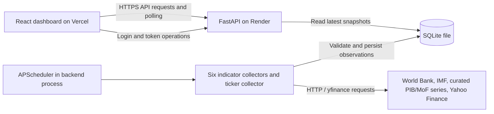

# Economic Indicators Dashboard

A web dashboard for exploring selected Indian and global economic indicators alongside a market-index ticker. A React frontend reads authenticated snapshots from a FastAPI backend; backend collectors validate and store provider data in SQLite on a schedule.

## Live deployment

| Resource | URL |
| --- | --- |
| Dashboard | [economic-indicators-dashboard-amber.vercel.app](https://economic-indicators-dashboard-amber.vercel.app/) |
| Backend API | [economic-indicators-api-y72p.onrender.com](https://economic-indicators-api-y72p.onrender.com) |
| Health check | [API `/health`](https://economic-indicators-api-y72p.onrender.com/health) |
| GitHub repository | [Ripusudan01/economic-indicators-dashboard](https://github.com/Ripusudan01/economic-indicators-dashboard) |

The URLs above are the deployment addresses supplied for this project. The repository configures the API to disable interactive documentation in production, so `/docs` and `/redoc` are not available in production mode.

## Contents

- [Overview](#overview)
- [Screenshots](#screenshots)
- [Features and indicators](#features-and-indicators)
- [Data sources and methodology](#data-sources-and-methodology)
- [Architecture](#architecture)
- [Technology stack](#technology-stack)
- [Repository structure](#repository-structure)
- [How collection and refresh work](#how-collection-and-refresh-work)
- [Authentication and security](#authentication-and-security)
- [Prerequisites and local setup](#prerequisites-and-local-setup)
- [Environment variables](#environment-variables)
- [API reference](#api-reference)
- [Database and persistence](#database-and-persistence)
- [Tests and validation](#tests-and-validation)
- [Production deployment](#production-deployment)
- [Troubleshooting](#troubleshooting)
- [Known limitations and future work](#known-limitations-and-future-work)
- [Contributing, license, and acknowledgements](#contributing-license-and-acknowledgements)

## Overview

The dashboard brings a set of economic series into one interface: GDP growth, public-debt ratios, trade, GST collections, inflation, government-finance measures, and selected market indices. It provides historical snapshots, source attribution, observation and fetch dates, chart summaries, and stale or unavailable states where the source data permits.

The browser communicates with the backend API. It does not call economic data providers directly. Indicator and ticker API requests read stored snapshots; refreshing the dashboard re-reads those snapshots and does not necessarily trigger a new upstream collection.

## Screenshots

There is no verified screenshot of the running application in the repository. The file [`extracted_figma_ref_0.png`](extracted_figma_ref_0.png) is an assignment design reference, not an application screenshot. Add a real screenshot here after capturing the deployed or locally running dashboard.

## Features and indicators

The authenticated dashboard contains six indicator panels:

| Panel | What it shows |
| --- | --- |
| **GDP growth** | Annual India growth alongside a world comparison. |
| **Inflation** | India CPI inflation and a configured 4% RBI target reference. |
| **Government debt** | IMF general-government gross debt as a percentage of GDP for India and the US. |
| **Government expenditure** | World Bank government-finance observations presented as total, revenue-proxy, and capital-proxy expenditure. |
| **GST collections** | Curated annual collections and a limited monthly series, including derived year-over-year changes. |
| **Trade** | Imports, exports, and a calculated trade balance. |

The page also provides:

- SENSEX, NIFTY BANK, and NIFTY IT ticker cards using Yahoo Finance daily bars.
- Login-protected dashboard and indicator/ticker API access.
- Charts, tooltips, loading, empty, error, stale, and unavailable states.
- Observation dates separate from backend fetch times where the provider date is available.
- Scheduled backend collection and snapshot persistence in SQLite.

The ticker is not described as real-time: its Yahoo Finance daily bars may be delayed and expose a date rather than a verified intraday quote time.

## Data sources and methodology

Sources and transformations below reflect the current collector code. The application does not certify that a provider is available or that its latest values have been independently validated.

| Data | Configured source | Frequency and handling |
| --- | --- | --- |
| GDP growth | [World Bank API](https://api.worldbank.org/v2/country/IN/indicator/NY.GDP.MKTP.KD.ZG?format=json&mrv=10), indicator `NY.GDP.MKTP.KD.ZG`, India and World. | Annual percentage observations, up to ten recent values. |
| Government debt | [IMF WEO DataMapper](https://www.imf.org/external/datamapper/api/v1/GGXWDG_NGDP/IND/USA), indicator `GGXWDG_NGDP`. | Annual gross general-government debt (% GDP), India and US. The endpoint provides year/value pairs but no reliable actual/estimate classification. Future calendar years are marked projections; current and elapsed years are not reliably classified and may include estimates. API `as_of` excludes future projections. |
| Imports and exports | [World Bank exports](https://api.worldbank.org/v2/country/IN/indicator/NE.EXP.GNFS.CD?format=json&mrv=10) (`NE.EXP.GNFS.CD`) and [imports](https://api.worldbank.org/v2/country/IN/indicator/NE.IMP.GNFS.CD?format=json&mrv=10) (`NE.IMP.GNFS.CD`). | Annual current USD series are converted to USD billions. Trade balance is derived as exports minus imports; it is not a separate source observation. |
| GST collections | Curated values attributed to [PIB / Ministry of Finance](https://www.pib.gov.in/PressNoteDetails.aspx?ModuleId=3&NoteId=154789&id=154789&lang=2&reg=3). | Static annual totals from FY2020–21 to FY2024–25; monthly values from April 2024 through February 2025. No live provider fetch occurs. The annual monthly line uses annual total divided by 12, an average proxy rather than observed months. |
| Inflation | [World Bank CPI inflation](https://api.worldbank.org/v2/country/IN/indicator/FP.CPI.TOTL.ZG?format=json&mrv=10), indicator `FP.CPI.TOTL.ZG`; application attribution also references MOSPI. | Annual CPI inflation percentage. The 4% RBI target is a configured comparison value, not a collected series. |
| Government expenditure | [World Bank expense](https://api.worldbank.org/v2/country/IN/indicator/GC.XPN.TOTL.GD.ZS?format=json&mrv=10), `GC.XPN.TOTL.GD.ZS`, and net investment in nonfinancial assets, `GC.NFN.TOTL.GD.ZS`. | Annual % GDP. “Revenue expenditure” is proxied by general-government expense; “capital expenditure” by net investment in nonfinancial assets; displayed total is their sum. This is not the Union Budget’s direct revenue/capital split. |
| Market ticker | Yahoo Finance via `yfinance`: `^BSESN`, `^NSEBANK`, `^CNXIT`; source attribution links to [Yahoo Finance](https://finance.yahoo.com). | Requests five days of daily bars. Observation dates are not verified intraday timestamps. Quotes may be delayed; this is not an official NSE/BSE feed. |

Economic freshness uses observation age rather than fetch time alone: annual observations become stale after 550 days and monthly observations after 62 days. Ticker observations with missing, invalid, future, or more than three-calendar-day-old dates are stale. A recent Yahoo daily bar is still labelled delayed. Collector errors preserve prior valid data where the collector supports it; a successful API read does not prove the upstream source supplied new data.

## Architecture



The API serves records from SQLite. APScheduler runs inside the backend process and collects separately from browser requests. The frontend’s ticker polling and dashboard reload are not collector triggers.

## Technology stack

| Area | Implementation |
| --- | --- |
| Frontend | React 19, Vite 8, Axios |
| Charts | Recharts |
| Backend | Python, FastAPI, Pydantic Settings, Uvicorn, HTTPX |
| Database | SQLite using Python `sqlite3` |
| Authentication | bcrypt password hashes and HS256 JWTs (`python-jose`); hashed, rotating refresh tokens |
| Scheduling | APScheduler `AsyncIOScheduler` |
| Ticker provider | `yfinance` / Yahoo Finance |
| Frontend lint | Oxlint |
| Backend tests | pytest |

`react-router-dom` appears in the frontend dependency manifest, but the current [`App.jsx`](frontend/src/App.jsx) does not use React Router: it selects login or dashboard based on authentication state. Oxlint is the linter invoked by `npm run lint`.

## Repository structure

```text
.
├── assignment.pdf
├── extracted_figma_ref_0.png       # assignment design reference, not app screenshot
├── README.md
├── backend/
│   ├── app/
│   │   ├── auth/                   # login, JWT and refresh-token logic
│   │   ├── collectors/             # six indicators, ticker, scheduler, validation
│   │   ├── models/schemas.py       # API response schemas
│   │   ├── routers/                # health, indicator, ticker endpoints
│   │   ├── utils/                  # HTTP client and freshness rules
│   │   ├── config.py
│   │   ├── database.py
│   │   └── main.py                 # FastAPI entry point and lifespan
│   ├── db/schema.sql
│   ├── tests/
│   ├── requirements.txt
│   └── requirements-dev.txt
└── frontend/
    ├── public/
    ├── src/
    │   ├── api/
    │   ├── auth/
    │   └── components/             # authentication, layout, panels and charts
    ├── tests/
    ├── package.json
    ├── package-lock.json
    └── vite.config.js
```

The repository has no `.env.example`, `render.yaml`, `vercel.json`, `LICENSE`, or GitHub Actions workflow. Local `.env` files, SQLite files, Python environments, `node_modules`, and frontend build output are ignored by Git.

## How collection and refresh work

When `SCHEDULER_ENABLED=true`, the backend runs an initial collection after startup, then schedules six daily collector jobs in UTC:

| Collector | UTC | India Standard Time (UTC+05:30) |
| --- | --- | --- |
| GDP growth | 02:00 | 07:30 |
| Debt-to-GDP | 02:30 | 08:00 |
| Trade | 03:00 | 08:30 |
| GST | 03:30 | 09:00 |
| Inflation | 04:00 | 09:30 |
| Government expenditure | 04:30 | 10:00 |

The ticker collector runs on its own `TICKER_REFRESH_SECONDS` interval (30 seconds by default). The frontend separately polls `GET /ticker` every 30 seconds. Dashboard “Reload data” and panel retry re-read stored API snapshots and do not force upstream collection.

Collectors use bounded provider request timeouts. On Render Free, the service can sleep while idle, so in-process scheduled jobs do not run while the service is stopped. Startup collection runs again when it wakes. Render Free uses an ephemeral filesystem; see [database persistence](#database-and-persistence).

## Authentication and security

`POST /auth/login` accepts a username and password. Passwords are bcrypt-hashed. The API issues HS256 access JWTs (30-minute default) and refresh tokens (7-day default); refresh tokens are stored as hashes, rotated on use, and can be revoked. Protected indicator and ticker requests use an `Authorization: Bearer` header. The frontend stores tokens in browser local storage; deployment should use HTTPS and protect against script injection.

Production startup requires a non-placeholder JWT secret of at least 32 UTF-8 bytes, a non-empty evaluator username, an evaluator password of 16–72 UTF-8 bytes with at least three character classes, and HTTPS CORS origins. JWT algorithm is restricted to HS256. Login limiting allows five failed attempts per client IP per rolling minute **per backend process**; it is in memory and is not shared between multiple workers.

Never place secrets in Vite variables: every `VITE_` variable is embedded into browser code. Do not commit `.env` files or database files.

## Prerequisites and local setup

- Python 3.10 or later; no exact Python version is pinned by this repository.
- Node.js compatible with Vite 8 (Vite 8 requires Node 20.19+ or 22.12+); npm.
- Git.

### Backend setup

PowerShell, from the repository root:

```powershell
cd backend
python -m venv .venv
.\.venv\Scripts\Activate.ps1
python -m pip install -r requirements-dev.txt
$env:APP_ENV = "development"
$env:JWT_SECRET_KEY = "replace-with-a-private-key-at-least-32-bytes"
$env:EVALUATOR_USERNAME = "evaluator"
$env:EVALUATOR_PASSWORD = "set-a-private-local-password"
$env:SCHEDULER_ENABLED = "false"
python -m uvicorn app.main:app --reload --host 127.0.0.1 --port 8000
```

For macOS/Linux, create/activate the environment with `python -m venv .venv` and `source .venv/bin/activate`, then set the same variables in the shell before running `python -m uvicorn app.main:app --reload --host 127.0.0.1 --port 8000`.

The backend initializes the SQLite schema on startup. Its default database URL is relative to the backend working directory, so start Uvicorn from `backend/` for the default `backend/db/indicators.db` location. Set `SCHEDULER_ENABLED=true` to enable the initial and scheduled collectors.

### Frontend setup

In another terminal, from the repository root:

```powershell
cd frontend
npm install
$env:VITE_API_BASE_URL = "http://localhost:8000"
npm run dev
```

For macOS/Linux, use `export VITE_API_BASE_URL=http://localhost:8000` before `npm run dev`. Vite uses port `5173` by default. The API base URL is compiled into the frontend; production builds require HTTPS.

There is no `.env.example`. The commands above use shell-session values and placeholders; replace the local password with a private value. Backend settings load `.env` from the backend process working directory if you choose to create a local ignored file.

## Environment variables

Backend names/defaults come from [`backend/app/config.py`](backend/app/config.py). Values marked production-required are enforced when `APP_ENV=production`.

| Variable | Purpose | Default / example format | Required |
| --- | --- | --- | --- |
| `APP_ENV` | Runtime mode and production checks. | `development`; production: `production` | Production deployment: yes |
| `JWT_SECRET_KEY` | Private JWT signing key. | Placeholder exists for development only; use a private random value at least 32 UTF-8 bytes in production. | Production: yes |
| `JWT_ALGORITHM` | JWT signing algorithm. | `HS256` | Optional, but only `HS256` is accepted |
| `ACCESS_TOKEN_EXPIRE_MINUTES` | Access-token lifetime. | `30` | Optional |
| `REFRESH_TOKEN_EXPIRE_DAYS` | Refresh-token lifetime. | `7` | Optional |
| `DATABASE_URL` | SQLite file URL. | `sqlite:///./db/indicators.db` | Optional; path is relative to backend process working directory unless absolute |
| `CORS_ORIGINS` | Comma-separated exact browser origins. | Local default `http://localhost:5173`; production example `https://your-project.vercel.app` | Production: yes, HTTPS only |
| `EVALUATOR_USERNAME` | Username seeded at backend startup. | `evaluator` | Production: yes, non-empty |
| `EVALUATOR_PASSWORD` | Password used to create/update the seeded evaluator. | Unset by default; use a private value meeting production policy. | Production: yes |
| `SCHEDULER_ENABLED` | Enables scheduler and startup collection. | `true` | Optional; set `true` for hosted collection |
| `TICKER_REFRESH_SECONDS` | Backend ticker collector interval. | `30` | Optional |
| `APP_TITLE` | API title metadata. | `Economic Indicators API` | Optional |
| `APP_VERSION` | API version metadata. | `1.0.0` | Optional |
| `VITE_API_BASE_URL` | Frontend API origin, embedded at build time. | Local: `http://localhost:8000`; production: `https://<render-service>.onrender.com` | Production frontend: yes |

`VITE_API_BASE_URL` is a frontend build-time setting, not a backend secret. On Render, `PORT` is platform-provided and should be consumed by the start command; it is not an application setting.

## API reference

All routes are mounted at the backend origin. `GET /health` and login/refresh are public. Logout requires an access token; indicator and ticker routes require a Bearer access token.

| Method | Path | Authentication | Purpose |
| --- | --- | --- | --- |
| `GET` | `/` | Public | API metadata and route hints; docs URL is `null` in production. |
| `GET` | `/health` | Public | API/database health, version, and timestamp. Database failure is reported in JSON as degraded/error (handler returns HTTP 200). |
| `POST` | `/auth/login` | Public | JSON body `{ "username": "…", "password": "…" }`; returns access and refresh tokens. Invalid credentials return 401; rate limits return 429. |
| `POST` | `/auth/refresh` | Refresh token in JSON body | Rotates the one-use refresh token and issues a new token pair. |
| `POST` | `/auth/logout` | Bearer access token and refresh token in body | Revokes the supplied refresh token; success is 204. |
| `GET` | `/indicators/gdp-growth` | Bearer | GDP snapshot. |
| `GET` | `/indicators/debt-gdp` | Bearer | Debt snapshot. |
| `GET` | `/indicators/trade` | Bearer | Trade snapshot. |
| `GET` | `/indicators/gst` | Bearer | GST snapshot. |
| `GET` | `/indicators/inflation` | Bearer | Inflation snapshot. |
| `GET` | `/indicators/govt-expenditure` | Bearer | Government expenditure snapshot. |
| `GET` | `/ticker` | Bearer | Latest stored market ticker rows. |

Indicator responses follow `IndicatorResponse`: `indicator`, `title`, `source`, `source_url`, `as_of`, `fetched_at`, `is_stale`, `series`, `summary`, and optional `note`. Each data point has `period`, nullable `value`, and nullable `classification` (`actual`, `estimate`, or `projection`). Ticker items include symbol/name, nullable quote/change values, source, fetch time, nullable provider observation date, stale boolean, and status (`fresh`, `delayed`, `stale`, or `unavailable`). Validation errors use FastAPI’s `detail` format; malformed bodies generally return 422.

Interactive `/docs`, `/redoc`, and `/openapi.json` are enabled outside production and disabled when `APP_ENV=production`.

## Database and persistence

SQLite is the database implementation. [`backend/app/database.py`](backend/app/database.py) resolves `DATABASE_URL`, creates its parent directory, opens the file, and runs [`backend/db/schema.sql`](backend/db/schema.sql) on startup. The schema contains:

- `users` for usernames, bcrypt password hashes, roles, and creation times.
- `indicator_snapshots` for indicator, series, period, values, units, source, observation date, fetch time, and stale status.
- `ticker_snapshots` for ticker values, fetch time, provider observation date, and stale status.
- `collector_runs` for collection status and counts.
- `refresh_tokens` for hashed refresh tokens, expiry, and revocation.

No PostgreSQL adapter is implemented; the application’s database helpers are SQLite-specific. The database is backend-only and is not committed to this repository. On Render Free, SQLite files on the service filesystem are ephemeral and may be lost on restart, redeploy, or spin-down. After database loss, the evaluator is seeded again from environment variables and collectors attempt to repopulate snapshots; other users, prior snapshots, and refresh-token records are not retained. A Render health result with `db: ok` verifies connectivity, not persistence.

## Tests and validation

From `backend/`, install dev dependencies and run tests:

```powershell
python -m pip install -r requirements-dev.txt
python -m pytest -q -p no:cacheprovider
```

The backend test configuration overrides `.env`, disables the scheduler, and uses a temporary SQLite database. It does not use the normal local DB.

From `frontend/`:

```powershell
npm run lint
npm run build
node --test tests/loginError.test.js
```

The frontend test uses Node’s built-in test runner; it checks login error classification. From the repository root, the Python syntax check and Git whitespace check are:

```powershell
python -m compileall -q backend/app backend/tests
git diff --check
```

## Production deployment

The repository contains no deployment manifest; configure each host using the values below.

### Render backend

Create a Python Web Service connected to this GitHub repository:

| Setting | Value |
| --- | --- |
| Root directory | `backend` |
| Build command | `pip install -r requirements.txt` |
| Start command | `uvicorn app.main:app --host 0.0.0.0 --port $PORT` |
| Health-check path | `/health` |
| Python version | Python 3.10+ syntax is required; choose and explicitly pin a compatible runtime in Render. |

Configure `APP_ENV=production`, `JWT_SECRET_KEY`, `CORS_ORIGINS`, `EVALUATOR_USERNAME`, and `EVALUATOR_PASSWORD` in Render’s environment settings. Set `SCHEDULER_ENABLED=true` if scheduled collection is wanted. The app reads Render’s assigned port only if the start command passes `$PORT`; the command must bind `0.0.0.0`.

### Vercel frontend

Create a Vercel project from the same repository:

| Setting | Value |
| --- | --- |
| Root directory | `frontend` |
| Framework preset | Vite |
| Install command | `npm install` (lockfile is in `frontend/`) |
| Build command | `npm run build` |
| Output directory | `dist` |
| Environment variable | `VITE_API_BASE_URL=https://<your-render-service>.onrender.com` |

The current app does not define URL-based routes, and no Vercel rewrite configuration is present or needed for its current login/dashboard state switch. If deep links are added later, configure SPA fallback routing then.

### CORS and deployment order

In Render, set `CORS_ORIGINS` to the exact Vercel production origin, for example `https://your-project.vercel.app` (no path or trailing slash). The deployed origin for this project is `https://economic-indicators-dashboard-amber.vercel.app`. Add preview origins only if those previews should access the API; the backend does not automatically allow arbitrary `*.vercel.app` domains. In Vercel, set `VITE_API_BASE_URL` to the exact Render API origin. Rebuild/redeploy the frontend after changing its `VITE_` value and restart/redeploy the backend after changing backend environment variables.

Render Free has an ephemeral filesystem and spins down idle web services. Consequently, SQLite persistence and continuous in-process schedules are not reliable on that plan. This deployment can be used for a demo, but snapshots and login/session data may be lost when the service restarts or sleeps. Verify persistence requirements before relying on it.

## Troubleshooting

### Login reports invalid credentials

The login username must exactly match the current Render `EVALUATOR_USERNAME` (including capitalization), and the password must match Render’s current `EVALUATOR_PASSWORD`. The startup code seeds the configured username, inserts it if absent, and updates the password hash if that same username already exists. Changing the username creates another row; it does not rename or delete the previous account. Never paste the password into an issue or log.

Inspect the browser Network panel for the `/auth/login` request:

- **401** means the backend rejected the submitted credentials. Check the Render evaluator settings and exact username entered, then save and redeploy if they were changed.
- **No response / CORS error** means the browser could not read an API response. Verify Vercel’s `VITE_API_BASE_URL` and Render’s exact `CORS_ORIGINS` value.
- **429** means the process-local login rate limit was reached; wait for the retry window to expire.

The frontend distinguishes unauthorized responses from network/CORS failures. An error shown by an older deployed frontend may still use a generic message for both.

### API unreachable or CORS blocked

Open the backend `/health` URL directly. Then confirm the frontend API base URL is HTTPS and points to the Render origin, and confirm that Render allows the frontend’s exact origin. Health availability does not prove that CORS is configured for Vercel.

### Health says database error or degraded

Inspect the backend logs without sharing secrets, confirm `DATABASE_URL` is a SQLite URL/path usable from the backend working directory, and allow startup to initialize the schema. The endpoint returns HTTP 200 even if the JSON reports degraded status, so inspect both fields.

### Dashboard panels are empty or stale

Confirm `SCHEDULER_ENABLED=true`, check collector logs, and allow initial background collection to finish. Each successful API request can still return old stored data. Stale labels use observation age, not merely the most recent fetch time.

### Local setup or deployment build fails

Confirm commands are run from the correct directory (`backend/` for Uvicorn and Python requirements; `frontend/` for npm), Python and Node meet dependency requirements, and the frontend’s build-time `VITE_API_BASE_URL` is correct. Vercel and Render settings are managed in their dashboards because this repository has no host manifest.

## Known limitations and future work

- Yahoo Finance daily bars may be delayed; a trustworthy intraday quote timestamp and official NSE-source compliance are not established.
- IMF WEO actual/estimate classifications are missing from the configured response for current and elapsed years.
- GST values are curated static data with limited monthly coverage; its annual-derived monthly average is an approximation.
- Government expenditure categories are proxies, not a direct Union Budget expenditure split.
- Historical coverage, current provider availability, and live deployment behavior may vary by provider and host configuration.
- Render Free does not provide durable local SQLite storage; data can be lost on restarts, redeploys, and spin-down.

Possible future work includes a verified market-data provider with reliable observation timestamps, expanded and independently checked GST history, improved persistence for deployments that require it, and browser-based visual regression tests. These items are not implemented guarantees.

## Contributing, license, and acknowledgements

For contributions, keep changes focused, describe any impact on data provenance or labels, and run backend tests plus frontend lint/build. Do not include credentials, `.env` files, local databases, or generated output.

No `LICENSE` file is present; this repository does not declare an open-source license.

Provider attributions in the code include the World Bank, IMF, PIB/Ministry of Finance, and RBI. Ticker data is obtained through Yahoo Finance using `yfinance`. Attribution does not imply provider endorsement; consult provider terms for data use.
